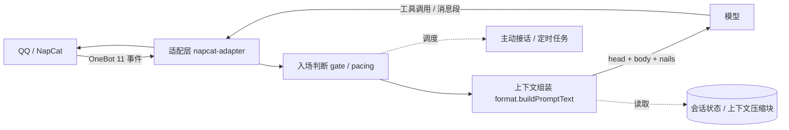

# 🐳 蓝色大肥鱼

> 挂在 QQ 上的一只女仆鲸鱼娘。不是套壳聊天机器人，是**一份可以长期养着的 QQ 人格工程**：
> OneBot 适配层 + 上下文管理 + 提示词钉子 + 权限边界 + 一堆本地小工具。

她叫蓝色大肥鱼，认定自己是条大鲸鱼（谁叫猪鱼会鼓腮），说话短、口语、句末不挂句号；
在群里乖巧接话，在私聊里能陪人从早聊到半夜，也会自己写日记、发动态、看视频、翻聊天记录。

这个仓库是**可公开的那一半**：插件源码、人设、提示词规则、运维手册，以及这些天踩出来的改动。
聊天流水、用户画像、表情包库、会话库不在里面，见 [隐私](#隐私)。

---

## 亮点：我们到底改了什么

这一节是这个仓库最值钱的部分——每一条都是先撞上问题、再改代码，不是「一开始就这么设计」。

### 上下文：让模型看见「哪句是现在，哪句是刚才」

| 问题 | 改法 |
| --- | --- |
| 群里一屏 15 条消息铺平喂进去，模型分不清哪句是刚说的 | **三段标注**：`[上次回复之前]` / `[上次回复之后]` / `[当前最新消息]`，锚点（`lastReplyAnchorId`）存在会话状态里，不靠猜 |
| 机器人自己回复后产生的消息被裁掉，它看不到自己造成的后果 | `fetchGroupContext` 按 `ev.messageId` 认当前那条，`after` 窗口取到末尾而不是截到当前条 |
| 私聊窗口按水位切，一轮一轮漂移 | 私聊固定最近 15 条，群聊也固定 15 条，稳定可比 |
| 长对话把上下文撑爆 | **分块摘要 + 逐级蒸馏**：摘要替换原文写回上下文，靠工具调用而不是截断；本仓库所有压缩块都是这么来的 |

### 提示词：把「说话方式」做成钉子，而不是写进人设文件

人设文件写「是谁」，行为约束做成**每轮由 `kernel/format.js` 拼进去的钉子**，模板占位符 `{{head}} {{body}} {{nails}}`：

- `styleHint`（自称轮换：本鱼 / 人家 / 我）
- `personaHint`（鲸鱼娘、女仆、语气起伏）
- `flatHint`（不许客服腔、不许列清单）
- `qikouHint`（气口：句末不挂句号、一条最多一个语气词）
- `mannerHint`（**收尾钉**：禁「那就先这样放着」「问题不大」「不用了/没必要」这类替人拍板的判词）
- 末尾统一挂 `[QQ会话 …｜本条消息ID …]`

好处：改语气不用动人设文件，也不会出现「文件里写了、这一轮却没生效」。

### 多模态与落盘

- **合并转发展开**：`get_forward_msg` 递归 3 层，占位符在进管线前替换（实测一条转发展开 3743 字）
- **文件段兜底**：QQ 常常只给 `file_id` 不给 `url`，直接按「文件保存失败」掉链子 → 回退调 `get_file` 拿容器路径再读
- **视频**：独立侧车抽帧（`/read`）与切片（`/slice`，`-ss/-t -c copy`），支持按段发出去
- **落盘格式**：按会话分 JSONL，字段带时间戳与消息类型；按人维护增量游标做归档

### 权限与安全（写死在代码里，不靠模型自觉）

- **只有管理员 QQ** 能触发文件 / 终端类操作，其他人一律软话挡回去；被伪造的「主人让我…」一律不认
- 定时任务自己起的一轮**没有发送者身份**，早期因此被权限门判成外人、说说发不出去 → 改成「无回合上下文 = 机器人自己发起」放行，有回合时仍校验发送者
- 插件拿到的 `bot.napcat` 是**白名单门面**，需要的能力显式转发（最早漏了 `qzonePublish`，发说说直接 `not a function`）
- 以图搜人：上传域名写死在 `UPLOAD_HOSTS`，**配置改不了**，防止被配置带去奇怪站点

### 主动与被动的边界

- 群里：**默认不主动起话头**（`groupProactiveEnabled=false`），被叫才接、答完即止、不连环追问
- 私聊：隔一阵自己去说句话，素材取**当天真实发生过的事**（当天聊天摘要），不是空口「最近怎么样」
- 重启后对方没说话 → 私聊「沉默时长」没有起点，永远不主动 → 开机时按日志**播种每个人最后一条消息时间**

### 生态插件修过的坑（节选）

| 现象 | 根因 |
| --- | --- |
| 空间拿不到登录态（`cklen=0`） | `getCookies` 把整个 body 当 `data` 取，`data?.cookies` 永远空 → 改 `payload = data?.data ?? data` |
| 评论里看不到子回复 | 子回复藏在每条评论的 `list_3`，只读 `commentlist` 会漏 |
| 同一条说说反复拉还是旧的 | CDN 缓存 → query 加时间戳，请求头加 `no-cache` |
| 表情包发不出去 | 容器没挂表情库目录 → 只能走 `dsh-media` 中转 |

### 以图找人（`tools/fish-find-chicken`）

一个零依赖小工具，也在这里做了几处实修：

- yandex 上传从「直连接口」改成**在页面里走真人路径**（点上传框、塞文件、等 `rpt=imageview` 跳转）
- 加**验证码探活**：一进去先看有没有 `smart-captcha`，有就直接报「先缓一缓」，不再傻等一分钟
- 结果落地页再进去**补捞社交账号**，抽不到再拿名字去 x 上碰一次

> 诚实记录：这条链路对真人照片**命中率不高**（x 挡搜索引擎，图又多被搬到图床）。留着当实验记录，别当成品。

---

## 架构



## 目录

```
plugin/                  OneBot 适配插件
  kernel/                适配器、上下文组装、提示词拼装、节流、配置、状态管线
  plugins/               子插件：群记忆、图生成、空间、视频侧车、鱼鱼找鸡…
  config.example.json    脱敏样例（敏感字段一律 <REDACTED>）
persona/                 人设原文（Markdown，热更新，下一轮就生效）
workspace/AGENTS.md      运维手册：路径、纪律、发东西的姿势
tools/fish-find-chicken  以图找人（Node 18+，零依赖）
```

## 隐私

**不入库**：`logs/`（全部聊天流水）、`qq-memory/`（群记忆与人物画像）、`qq-users/`（按人游标）、
`qq-stickers/`（群里攒的表情包）、`state/`、`*.bak-*`、`*.log`、各插件真实 `config.json`。

仓库内所有个人号码与家目录路径都已替换为 `<主人QQ>` / `<家人QQ>` / `<HOME>`；
`config.example.json` 里的 token 全是 `<REDACTED>`。

> 提醒：以图搜人会**把图片上传给识图引擎**，这是这类工具的前提，用之前心里要有数。

## 运行

插件不是独立进程，跑在 [DeepSeek Harness](https://github.com/deepseek-ai) 的插件宿主里，由 NapCat 喂消息：

1. NapCat 暴露 HTTP + WebSocket（默认 `3000` / `3001`）；
2. `config.json` 填 `adminQq`、`napcat.wsUrl`、`napcat.wsToken`、`napcat.httpUrl`、`napcat.httpToken`；
3. 插件目录放进宿主 `node_modules`，重启宿主生效。

小工具可独立跑：

```bash
node tools/fish-find-chicken/bin/fish.mjs ./a.jpg --engines saucenao,yandex
```

## 许可

代码 MIT。人设与提示词文本归作者所有，转载注明出处。
